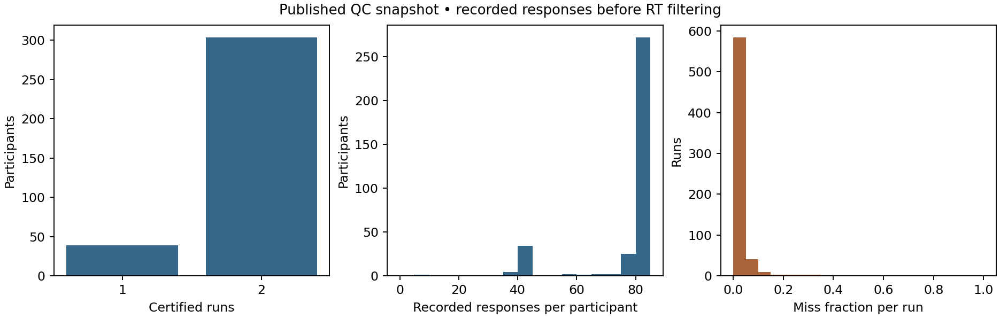

# RF1 Trust Game DDM feasibility assessment

## Decision

**Scientific GREEN/YELLOW/RED verdict pending. Do not proceed to the amended individual-difference tests.**
This is an infrastructure/data-readiness report, not an empirical DDM feasibility finding. Only published canonical QC metadata have been examined locally. The user will run the canonical audit and bounded recovery pilot on Linux2. No current RT distribution, choice-variability exclusion count, individual-z reliability, group DDM effect, or partner-specific recovery has been established.

## Data readiness

Evidence: published upstream QC snapshot; current BIDS files not yet verified. Upstream revision `3ecbc8f4fb5554911b815bcb214561b9b9ca196c`. These are session-01 behavioral counts; imaging QC, demographics and external outcomes do not define this audit sample.

| Quantity | Count |
|---|---:|
| Participants with certified runs | 343 |
| Certified runs | 647 |
| Two-run / one-run participants | 304 / 39 |
| Decision opportunities | 27,143 |
| Misses | 583 (2.15%) |
| Recorded responses before RT checks | 26,560 |

Run lengths in this QC snapshot: 1 with 11 decisions, 646 with 42 decisions. The documented complete design has 14 trials per partner per run: at most 28 per partner across two complete runs, before misses, RT filtering and variability exclusions. The expanded cohort increases the number of people, not the observations available for each person's partner-specific parameters. Recorded responses per participant have median 83, range 9–84 in this snapshot. These nominal partner counts are design facts, not a direct audit of every person's partner cells.

**Still unavailable:** valid RT counts per partner/run, RT distributions by offer and choice, sub-200-ms rates, friend/stranger choice-variability exclusions, high/low frequencies and live schema verification. The local participant inventory records QC-available trials and marks DDM eligibility unassessed; it is not a final eligibility table.

## Estimand and candidate specifications

Set the upper boundary to **higher investment**, the lower boundary to lower investment, and express z as a proportion of boundary separation. Thus z > .5 indicates an initial predisposition toward higher investment in that partner condition. Define the paired contrast as z_friend − z_stranger; a negative contrast indicates relatively greater high-investment starting bias for strangers. A DDM trial has one partner, so z cannot literally encode a choice between friend and stranger. Because the motor mapping of higher investment can change with the offers, content-coded z is an operational response-bias parameter; it does not itself establish a pre-offer trust predisposition. Verify partner-cue and response-mapping timing. The precise hypothesis direction must be checked against the actual amendment before confirmation.

The user-supplied brief is the working specification. OSF 8T5QN and its September 2, 2025 amendment could not be retrieved here; the exact wording, exclusion denominator and interpretation remain to be checked. No alternative registration has been substituted.

1. **Shared z:** participant-specific boundary a, nondecision t0, three partner drift intercepts, one common within-person offer-gap slope, and one z (7 parameters).
2. **Partner z:** the same nuisance structure with three z values (9 parameters). Drift is v_partner + beta_gap × ((high−low)/8 − .5). This is a minimal investment-sensitive drift, not a fitted expected-value or reinforcement-learning mechanism. Zero-option, amount-level and learning misspecification remain potential obstacles.
3. **Hierarchical partner z:** deferred until the basic screen merits expansion. A future hierarchy should partially pool latent partner biases and their difference while allowing partner drift; recover the participant contrast and its population variance from full posteriors. Shrinkage or population significance alone cannot establish individual reliability.

The pilot fixes diffusion noise SD to 1, retains common a/t0 across partners, and omits across-trial variability parameters. It uses the joint choice/RT density, conditional on the retained 0.2–3 s interval, plus a fixed 1% uniform contaminant. The 3-s deadline is provisional and must be checked against canonical task documentation. A zero investment is a legitimate low choice, never a miss. Missed rows and RT placeholders never enter the likelihood. Response side is inferred from independently validated left/right offers; this is not an independent raw button-log check. The prototype supports side and lag-feedback regressors, but the default pilot does not fit them.

## Recovery and diagnostics

The Linux2 pilot selects at most 24 eligible participants stratified across available trial counts, uses their exact offers, partner order, runs and original response/RT rejection masks, and generates fresh parameters independent of observed fits. It uses two independent datasets per small/moderate/large z SD (.03/.08/.15), fitting both candidates from four starts. Eight schedules receive paired wider-bound/prior checks, a drift-only null-z contrast, a shared-z generator, a smaller simulation time step, and a fully generative learning stress test that reveals programmed feedback only after a valid positive investment. A bounded observed pilot fits eight count-stratified participants and generates 40 plug-in predictive datasets per fit. This is up to 360 simulated fits and 16 observed fits, on one process. It does not expand to a full-cohort DDM fit.

The declared operational screen requires, in both moderate-SD replicates, r ≥ .80 and RMSE ≤ .05 for friend z, stranger z and their difference, ≤5% bound hits, and ≥95% full multistart agreement. These are prospective engineering/scientific review criteria, not OSF-registered thresholds. Small-SD failures, stress sensitivity, extreme simulated responders and minority-choice scarcity must still constrain any favorable moderate-SD result. The central target is individual reliability, not optimizer convergence or a significant population coefficient.

**No actual-schedule recovery or observed DDM fit has been run in this handoff.** Numerical tests of the likelihood/simulator are software checks and do not establish RF1 parameter recovery.

Plug-in predictive intervals omit parameter uncertainty; they are explicitly **not posterior predictive checks**. The pilot has no posterior interval coverage, MCMC convergence diagnostics, hierarchical comparison, or validated group-effect estimates. A fixed empirical missingness mask assumes omissions are noninformative; deadline/lapse mechanisms can violate that assumption. Recovery is reported before and with flags for simulated choice-rule exclusions, which must be examined for selection bias. Recovery-error correlations describe confounding across simulated fits, not posterior parameter dependence.

## Additional work if the pilot warrants proceeding

Verify amendment wording and deadline; review all exact-offer/RT cells and sparse minority-choice cells; inspect bias and stability by trial-count stratum and extreme responding; extend generative drift-versus-z discrimination with controlled z and drift effects; evaluate zero-option/amount-level and history/motor misspecification; and then, only if justified, run a bounded hierarchical study with full uncertainty, convergence diagnostics, interval calibration and posterior predictive checks. Assess individual ranks and contrasts under partial pooling, including low-variance cases. Only a later scientifically reviewed GREEN decision can support subsequent association testing. No age, FEVS, social-closeness or neural association is run by this workflow.

## Files and privacy

Public aggregate results, figures and provenance are in this directory. Private participant eligibility, participant×partner×run counts, canonical trial table, source-event hashes, simulation truths and individual fitted values stay under ignored `work/ddm/`. The completed N=111 and existing expanded-cohort modeling outputs are unchanged. Reproduction and Linux2 commands: [workflow](../../feasibility/ddm/README.md).

## References

- [Canonical upstream handoff](https://github.com/DVS-Lab/rf1-sra-linux2/tree/main/qc/trust_analysis).
- [Existing task audit](../../docs/data_audit.md).
- [Practical DDM introduction](https://doi.org/10.3389/fpsyg.2022.1039172): joint choice/RT fitting and recovery checks.
- [HDDM](https://doi.org/10.3389/fninf.2013.00014): hierarchical estimation with partial pooling.
